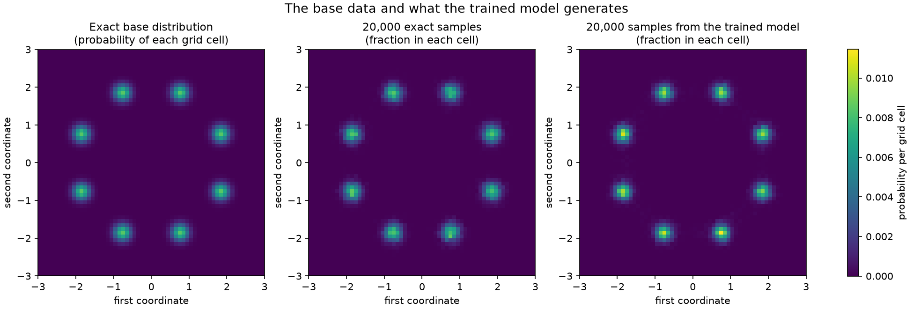
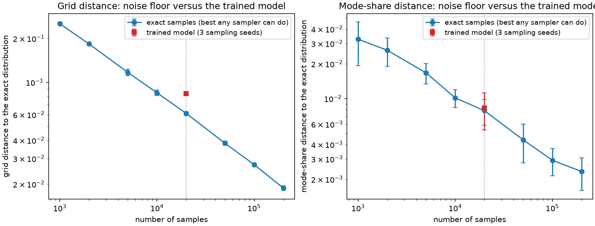
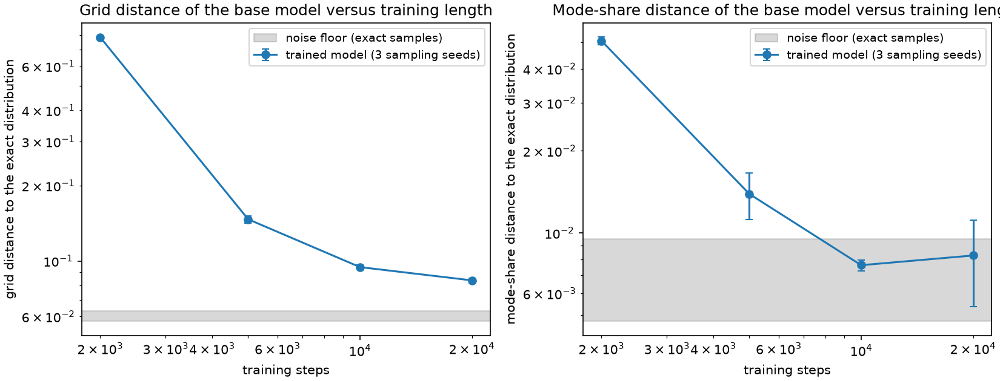
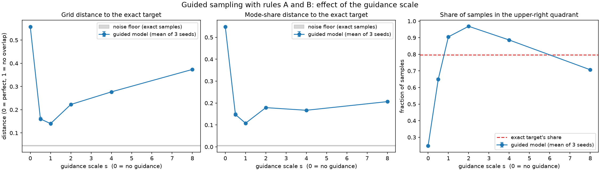
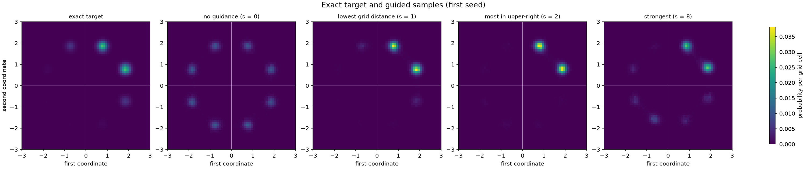
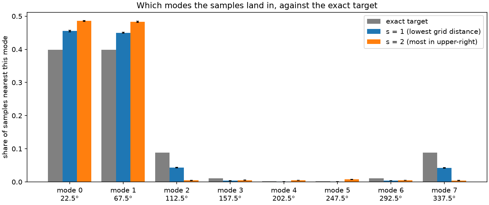
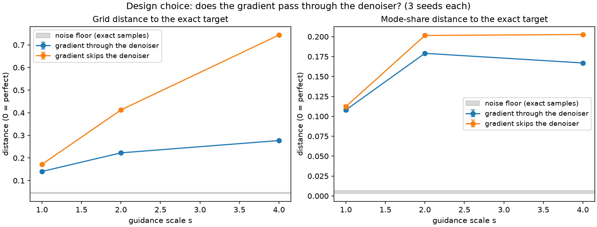
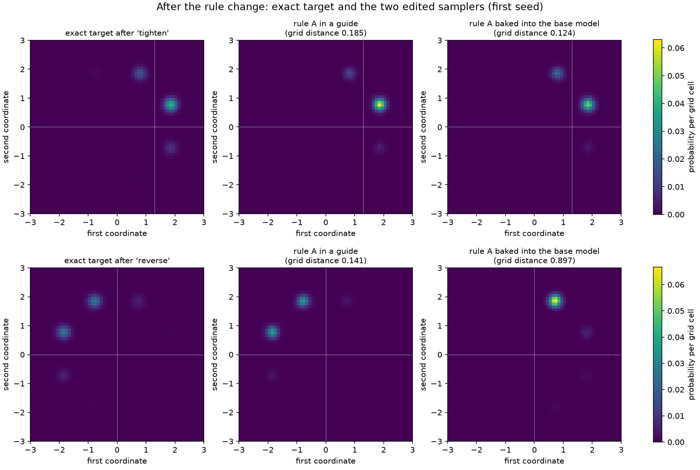
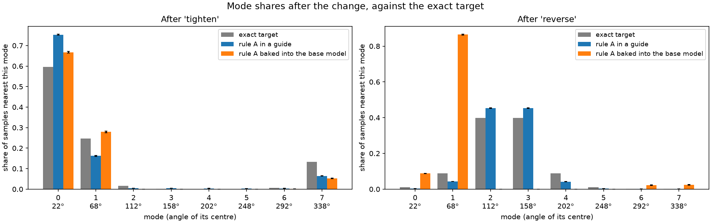

# Part A results

All distances use 20,000 samples. ± is one standard deviation across seeds.

| What is scored against exact p0 | Seeds | Grid distance | Mode-share distance |
|---|---|---|---|
| Exact samples (noise floor) | 20 | 0.0602 ± 0.0029 | 0.0071 ± 0.0024 |
| Unguided base model (20,000 training steps) | 3 | 0.0837 ± 0.0018 | 0.0083 ± 0.0029 |

## Base-model error versus training length

| Training steps | Grid distance | Mode-share distance |
|---|---|---|
| 2,000 | 0.7828 ± 0.0024 | 0.0507 ± 0.0016 |
| 5,000 | 0.1468 ± 0.0049 | 0.0139 ± 0.0027 |
| 10,000 | 0.0945 ± 0.0017 | 0.0076 ± 0.0004 |
| 20,000 | 0.0837 ± 0.0018 | 0.0083 ± 0.0029 |

## Known-answer checks

| Check | Value |
|---|---|
| grid: target equals the sample histogram (expect 0) | 0.00000 |
| grid: one mode only vs p0 (expect 7/8 = 0.875) | 0.87501 |
| mode share: one mode only vs p0 (expect 7/8 = 0.875) | 0.87500 |
| exact masses: closed form vs numerical integration, TV (expect ~0) | 0.00003 |
| exact mode shares by integration, max error vs 1/8 (expect ~0) | 0.00000 |

---

# Part B results: guided sampling with rules A and B

Target: p* = p0 reweighted by rules A and B. Every row uses 20,000 samples per seed, seeds [1, 2, 3]; ± is one standard deviation across seeds.

Sampler: DDPM, 1000 steps, gradient through the denoiser.

Exact share of the target in the upper-right quadrant: 0.7973

| Guidance scale s | Grid distance | Mode-share distance | Upper-right share | Non-finite samples |
|---|---|---|---|---|
| 0 | 0.5571 ± 0.0030 | 0.5480 ± 0.0028 | 0.249 ± 0.003 | 0 |
| 0.5 | 0.1605 ± 0.0057 | 0.1476 ± 0.0061 | 0.650 ± 0.006 | 0 |
| 1 | 0.1402 ± 0.0041 | 0.1080 ± 0.0020 | 0.905 ± 0.002 | 0 |
| 2 | 0.2226 ± 0.0007 | 0.1791 ± 0.0008 | 0.969 ± 0.001 | 0 |
| 4 | 0.2770 ± 0.0018 | 0.1670 ± 0.0004 | 0.886 ± 0.003 | 0 |
| 8 | 0.3737 ± 0.0018 | 0.2065 ± 0.0017 | 0.707 ± 0.002 | 0 |
| exact samples (noise floor, 20 seeds) | 0.0450 ± 0.0020 | 0.0049 ± 0.0018 | 0.797 ± 0.002 | 0 |

## Mode shares (mean over seeds) beside the exact shares

| Mode (angle) | Exact | s = 0 | s = 0.5 | s = 1 | s = 2 | s = 4 | s = 8 |
|---|---|---|---|---|---|---|---|
| 0 (22.5°) | 0.3986 | 0.1255 | 0.3273 | 0.4553 | 0.4855 | 0.4398 | 0.3628 |
| 1 (67.5°) | 0.3986 | 0.1238 | 0.3223 | 0.4500 | 0.4833 | 0.4465 | 0.3441 |
| 2 (112.5°) | 0.0887 | 0.1230 | 0.1177 | 0.0428 | 0.0044 | 0.0041 | 0.0099 |
| 3 (157.5°) | 0.0103 | 0.1273 | 0.0381 | 0.0037 | 0.0052 | 0.0196 | 0.0388 |
| 4 (202.5°) | 0.0023 | 0.1237 | 0.0187 | 0.0011 | 0.0047 | 0.0202 | 0.0535 |
| 5 (247.5°) | 0.0023 | 0.1257 | 0.0187 | 0.0011 | 0.0074 | 0.0486 | 0.0988 |
| 6 (292.5°) | 0.0103 | 0.1278 | 0.0381 | 0.0036 | 0.0052 | 0.0148 | 0.0406 |
| 7 (337.5°) | 0.0887 | 0.1233 | 0.1189 | 0.0425 | 0.0043 | 0.0064 | 0.0514 |

## Facts for the explanation

- s_with_lowest_grid_distance: 1.0000
- s_with_lowest_mode_share_distance: 1.0000
- s_with_most_upper_right_samples: 2.0000
- exact_upper_right_share: 0.7973

---

# Part B design choice: gradient through the denoiser or not

Hypothesis: see HYPOTHESIS_B.md (committed before this run).

| Variant | s | Grid distance | Mode-share distance | Upper-right share | Seconds per run |
|---|---|---|---|---|---|
| gradient through the denoiser | 1 | 0.1402 ± 0.0041 | 0.1080 ± 0.0020 | 0.905 ± 0.002 | 29 |
| gradient through the denoiser | 2 | 0.2226 ± 0.0007 | 0.1791 ± 0.0008 | 0.969 ± 0.001 | 30 |
| gradient through the denoiser | 4 | 0.2770 ± 0.0018 | 0.1670 ± 0.0004 | 0.886 ± 0.003 | 29 |
| gradient skips the denoiser | 1 | 0.1719 ± 0.0038 | 0.1122 ± 0.0023 | 0.910 ± 0.002 | 13 |
| gradient skips the denoiser | 2 | 0.4125 ± 0.0011 | 0.2015 ± 0.0001 | 0.999 ± 0.000 | 13 |
| gradient skips the denoiser | 4 | 0.7437 ± 0.0023 | 0.2027 ± 0.0000 | 1.000 ± 0.000 | 13 |
| exact samples (noise floor) | – | 0.0450 ± 0.0020 | 0.0049 ± 0.0018 | 0.797 (exact) | – |

---

# Part C results: four cells after a rule change

Guidance scale s = 1 in every cell. 20,000 samples per seed, seeds [1, 2, 3]; ± is one standard deviation across seeds.

Each cell is scored against its NEW exact target: p0 reweighted by A' and B.

## Grid distance

| Where rule A lives | Tighten (x1 > 1.3) | Reverse (x1 < 0) |
|---|---|---|
| rule A in a guide | 0.1847 ± 0.0035 | 0.1413 ± 0.0034 |
| rule A baked into the base model | 0.1238 ± 0.0032 | 0.8967 ± 0.0001 |
| exact samples (noise floor) | 0.0400 ± 0.0024 | 0.0446 ± 0.0017 |

## Mode-share distance

| Where rule A lives | Tighten (x1 > 1.3) | Reverse (x1 < 0) |
|---|---|---|
| rule A in a guide | 0.1671 ± 0.0031 | 0.1083 ± 0.0004 |
| rule A baked into the base model | 0.1037 ± 0.0015 | 0.8963 ± 0.0000 |
| exact samples (noise floor) | 0.0041 ± 0.0016 | 0.0058 ± 0.0019 |

## Mode shares after 'tighten' (mean ± sd over seeds)

| Mode (angle) | Exact | Guide cell | Baked cell |
|---|---|---|---|
| 0 (22.5°) | 0.5957 | 0.7531 ± 0.0031 | 0.6676 ± 0.0049 |
| 1 (67.5°) | 0.2473 | 0.1620 ± 0.0022 | 0.2791 ± 0.0038 |
| 2 (112.5°) | 0.0157 | 0.0044 ± 0.0004 | 0.0000 ± 0.0000 |
| 3 (157.5°) | 0.0015 | 0.0050 ± 0.0004 | 0.0000 ± 0.0000 |
| 4 (202.5°) | 0.0003 | 0.0037 ± 0.0003 | 0.0000 ± 0.0000 |
| 5 (247.5°) | 0.0004 | 0.0034 ± 0.0003 | 0.0000 ± 0.0000 |
| 6 (292.5°) | 0.0064 | 0.0038 ± 0.0002 | 0.0011 ± 0.0002 |
| 7 (337.5°) | 0.1326 | 0.0646 ± 0.0012 | 0.0522 ± 0.0013 |

## Mode shares after 'reverse' (mean ± sd over seeds)

| Mode (angle) | Exact | Guide cell | Baked cell |
|---|---|---|---|
| 0 (22.5°) | 0.0103 | 0.0038 ± 0.0003 | 0.0885 ± 0.0009 |
| 1 (67.5°) | 0.0887 | 0.0434 ± 0.0003 | 0.8650 ± 0.0027 |
| 2 (112.5°) | 0.3986 | 0.4530 ± 0.0025 | 0.0000 ± 0.0000 |
| 3 (157.5°) | 0.3986 | 0.4526 ± 0.0021 | 0.0000 ± 0.0000 |
| 4 (202.5°) | 0.0887 | 0.0419 ± 0.0004 | 0.0000 ± 0.0000 |
| 5 (247.5°) | 0.0103 | 0.0034 ± 0.0009 | 0.0000 ± 0.0000 |
| 6 (292.5°) | 0.0023 | 0.0008 ± 0.0002 | 0.0228 ± 0.0016 |
| 7 (337.5°) | 0.0023 | 0.0010 ± 0.0002 | 0.0237 ± 0.0016 |

Worst cell (grid distance minus its noise floor): **baked/reverse**

