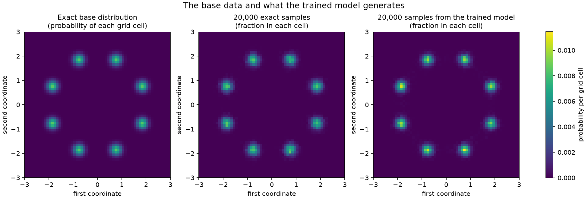
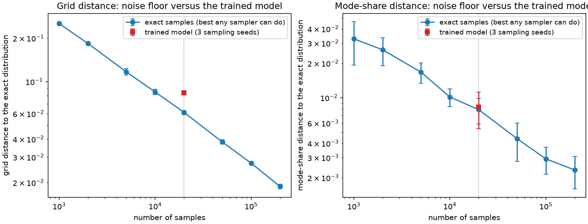
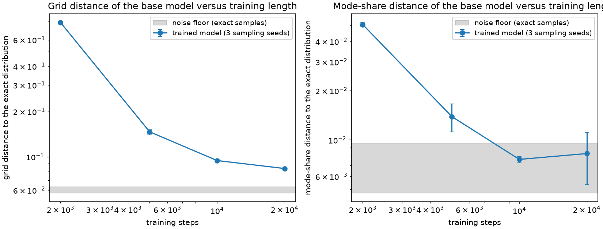

# Part A results

All distances use 20,000 samples. ± is one standard deviation across seeds.

| What is scored against exact p0 | Seeds | Grid distance | Mode-share distance |
|---|---|---|---|
| Exact samples (noise floor) | 20 | 0.0602 ± 0.0029 | 0.0071 ± 0.0024 |
| Unguided base model (20,000 training steps) | 3 | 0.0837 ± 0.0018 | 0.0083 ± 0.0029 |

## Base-model error versus training length

| Training steps | Grid distance | Mode-share distance |
|---|---|---|
| 2,000 | 0.7828 ± 0.0024 | 0.0507 ± 0.0016 |
| 5,000 | 0.1468 ± 0.0049 | 0.0139 ± 0.0027 |
| 10,000 | 0.0945 ± 0.0017 | 0.0076 ± 0.0004 |
| 20,000 | 0.0837 ± 0.0018 | 0.0083 ± 0.0029 |

## Known-answer checks

| Check | Value |
|---|---|
| grid: target equals the sample histogram (expect 0) | 0.00000 |
| grid: one mode only vs p0 (expect 7/8 = 0.875) | 0.87501 |
| mode share: one mode only vs p0 (expect 7/8 = 0.875) | 0.87500 |
| exact masses: closed form vs numerical integration, TV (expect ~0) | 0.00003 |
| exact mode shares by integration, max error vs 1/8 (expect ~0) | 0.00000 |

