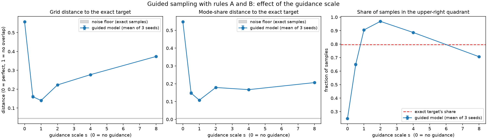
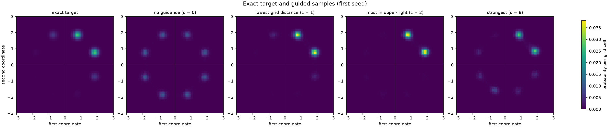
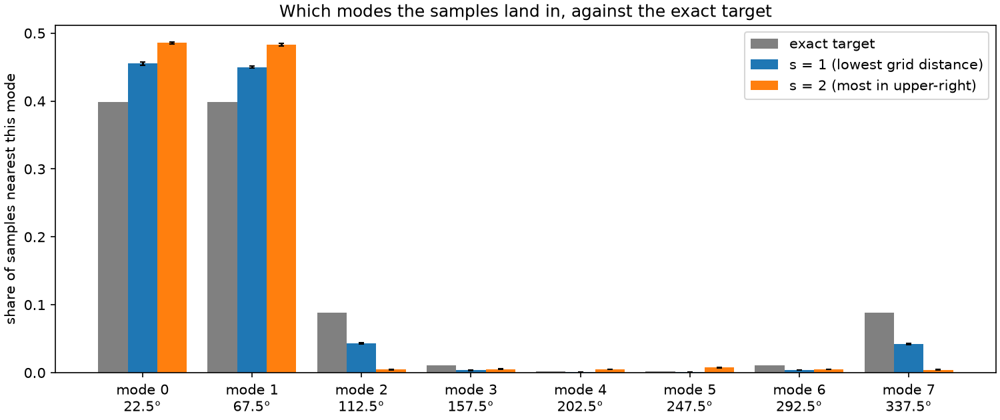

# Part B results: guided sampling with rules A and B

Target: p* = p0 reweighted by rules A and B. Every row uses 20,000 samples per seed, seeds [1, 2, 3]; ± is one standard deviation across seeds.

Sampler: DDPM, 1000 steps, gradient through the denoiser.

Exact share of the target in the upper-right quadrant: 0.7973

| Guidance scale s | Grid distance | Mode-share distance | Upper-right share | Non-finite samples |
|---|---|---|---|---|
| 0 | 0.5571 ± 0.0030 | 0.5480 ± 0.0028 | 0.249 ± 0.003 | 0 |
| 0.5 | 0.1605 ± 0.0057 | 0.1476 ± 0.0061 | 0.650 ± 0.006 | 0 |
| 1 | 0.1402 ± 0.0041 | 0.1080 ± 0.0020 | 0.905 ± 0.002 | 0 |
| 2 | 0.2226 ± 0.0007 | 0.1791 ± 0.0008 | 0.969 ± 0.001 | 0 |
| 4 | 0.2770 ± 0.0018 | 0.1670 ± 0.0004 | 0.886 ± 0.003 | 0 |
| 8 | 0.3737 ± 0.0018 | 0.2065 ± 0.0017 | 0.707 ± 0.002 | 0 |
| exact samples (noise floor, 20 seeds) | 0.0450 ± 0.0020 | 0.0049 ± 0.0018 | 0.797 ± 0.002 | 0 |

## Mode shares (mean over seeds) beside the exact shares

| Mode (angle) | Exact | s = 0 | s = 0.5 | s = 1 | s = 2 | s = 4 | s = 8 |
|---|---|---|---|---|---|---|---|
| 0 (22.5°) | 0.3986 | 0.1255 | 0.3273 | 0.4553 | 0.4855 | 0.4398 | 0.3628 |
| 1 (67.5°) | 0.3986 | 0.1238 | 0.3223 | 0.4500 | 0.4833 | 0.4465 | 0.3441 |
| 2 (112.5°) | 0.0887 | 0.1230 | 0.1177 | 0.0428 | 0.0044 | 0.0041 | 0.0099 |
| 3 (157.5°) | 0.0103 | 0.1273 | 0.0381 | 0.0037 | 0.0052 | 0.0196 | 0.0388 |
| 4 (202.5°) | 0.0023 | 0.1237 | 0.0187 | 0.0011 | 0.0047 | 0.0202 | 0.0535 |
| 5 (247.5°) | 0.0023 | 0.1257 | 0.0187 | 0.0011 | 0.0074 | 0.0486 | 0.0988 |
| 6 (292.5°) | 0.0103 | 0.1278 | 0.0381 | 0.0036 | 0.0052 | 0.0148 | 0.0406 |
| 7 (337.5°) | 0.0887 | 0.1233 | 0.1189 | 0.0425 | 0.0043 | 0.0064 | 0.0514 |

## Facts for the explanation

- s_with_lowest_grid_distance: 1.0000
- s_with_lowest_mode_share_distance: 1.0000
- s_with_most_upper_right_samples: 2.0000
- exact_upper_right_share: 0.7973

