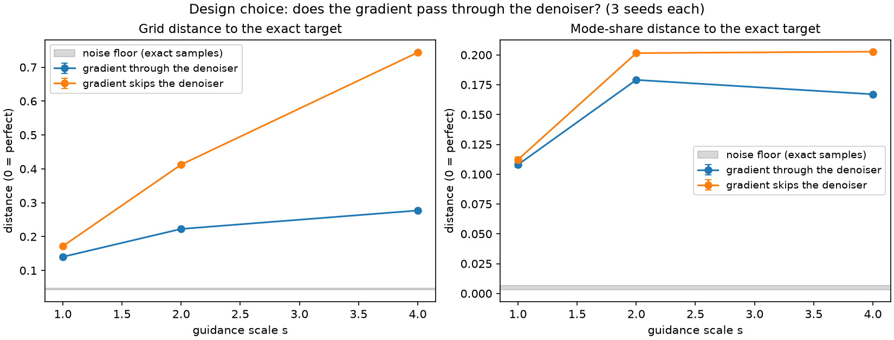

# Part B design choice: gradient through the denoiser or not

Hypothesis: see HYPOTHESIS_B.md (committed before this run).

| Variant | s | Grid distance | Mode-share distance | Upper-right share | Seconds per run |
|---|---|---|---|---|---|
| gradient through the denoiser | 1 | 0.1402 ± 0.0041 | 0.1080 ± 0.0020 | 0.905 ± 0.002 | 29 |
| gradient through the denoiser | 2 | 0.2226 ± 0.0007 | 0.1791 ± 0.0008 | 0.969 ± 0.001 | 30 |
| gradient through the denoiser | 4 | 0.2770 ± 0.0018 | 0.1670 ± 0.0004 | 0.886 ± 0.003 | 29 |
| gradient skips the denoiser | 1 | 0.1719 ± 0.0038 | 0.1122 ± 0.0023 | 0.910 ± 0.002 | 13 |
| gradient skips the denoiser | 2 | 0.4125 ± 0.0011 | 0.2015 ± 0.0001 | 0.999 ± 0.000 | 13 |
| gradient skips the denoiser | 4 | 0.7437 ± 0.0023 | 0.2027 ± 0.0000 | 1.000 ± 0.000 | 13 |
| exact samples (noise floor) | – | 0.0450 ± 0.0020 | 0.0049 ± 0.0018 | 0.797 (exact) | – |

