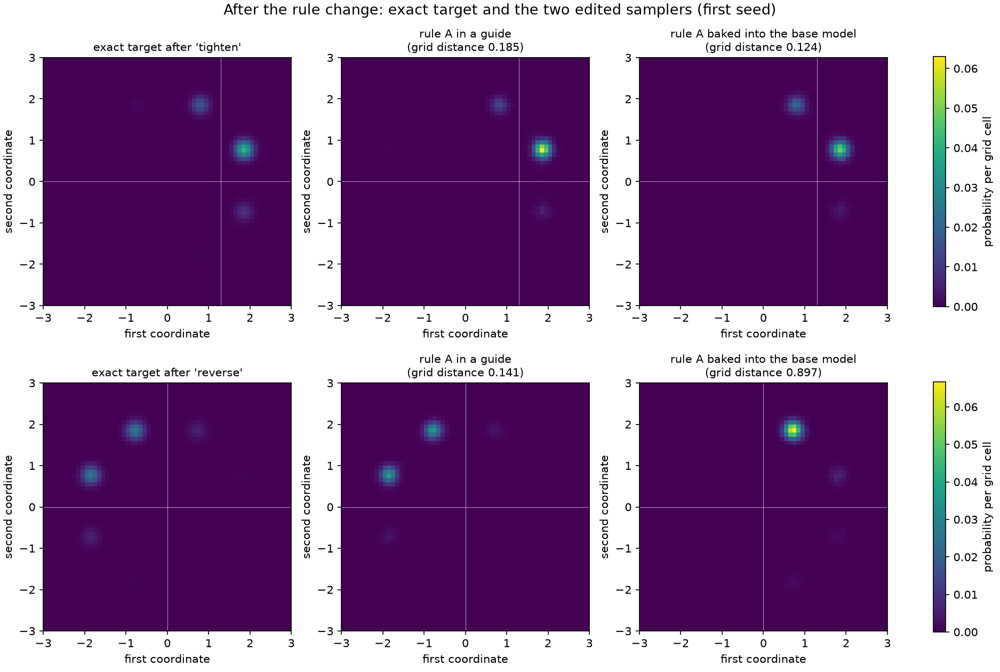
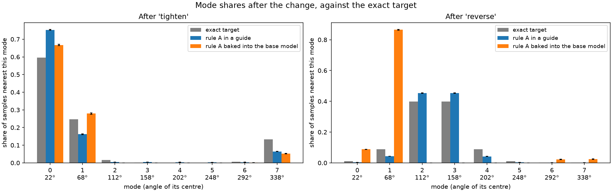

# Part C results: four cells after a rule change

Guidance scale s = 1 in every cell. 20,000 samples per seed, seeds [1, 2, 3]; ± is one standard deviation across seeds.

Each cell is scored against its NEW exact target: p0 reweighted by A' and B.

## Grid distance

| Where rule A lives | Tighten (x1 > 1.3) | Reverse (x1 < 0) |
|---|---|---|
| rule A in a guide | 0.1847 ± 0.0035 | 0.1413 ± 0.0034 |
| rule A baked into the base model | 0.1238 ± 0.0032 | 0.8967 ± 0.0001 |
| exact samples (noise floor) | 0.0400 ± 0.0024 | 0.0446 ± 0.0017 |

## Mode-share distance

| Where rule A lives | Tighten (x1 > 1.3) | Reverse (x1 < 0) |
|---|---|---|
| rule A in a guide | 0.1671 ± 0.0031 | 0.1083 ± 0.0004 |
| rule A baked into the base model | 0.1037 ± 0.0015 | 0.8963 ± 0.0000 |
| exact samples (noise floor) | 0.0041 ± 0.0016 | 0.0058 ± 0.0019 |

## Mode shares after 'tighten' (mean ± sd over seeds)

| Mode (angle) | Exact | Guide cell | Baked cell |
|---|---|---|---|
| 0 (22.5°) | 0.5957 | 0.7531 ± 0.0031 | 0.6676 ± 0.0049 |
| 1 (67.5°) | 0.2473 | 0.1620 ± 0.0022 | 0.2791 ± 0.0038 |
| 2 (112.5°) | 0.0157 | 0.0044 ± 0.0004 | 0.0000 ± 0.0000 |
| 3 (157.5°) | 0.0015 | 0.0050 ± 0.0004 | 0.0000 ± 0.0000 |
| 4 (202.5°) | 0.0003 | 0.0037 ± 0.0003 | 0.0000 ± 0.0000 |
| 5 (247.5°) | 0.0004 | 0.0034 ± 0.0003 | 0.0000 ± 0.0000 |
| 6 (292.5°) | 0.0064 | 0.0038 ± 0.0002 | 0.0011 ± 0.0002 |
| 7 (337.5°) | 0.1326 | 0.0646 ± 0.0012 | 0.0522 ± 0.0013 |

## Mode shares after 'reverse' (mean ± sd over seeds)

| Mode (angle) | Exact | Guide cell | Baked cell |
|---|---|---|---|
| 0 (22.5°) | 0.0103 | 0.0038 ± 0.0003 | 0.0885 ± 0.0009 |
| 1 (67.5°) | 0.0887 | 0.0434 ± 0.0003 | 0.8650 ± 0.0027 |
| 2 (112.5°) | 0.3986 | 0.4530 ± 0.0025 | 0.0000 ± 0.0000 |
| 3 (157.5°) | 0.3986 | 0.4526 ± 0.0021 | 0.0000 ± 0.0000 |
| 4 (202.5°) | 0.0887 | 0.0419 ± 0.0004 | 0.0000 ± 0.0000 |
| 5 (247.5°) | 0.0103 | 0.0034 ± 0.0009 | 0.0000 ± 0.0000 |
| 6 (292.5°) | 0.0023 | 0.0008 ± 0.0002 | 0.0228 ± 0.0016 |
| 7 (337.5°) | 0.0023 | 0.0010 ± 0.0002 | 0.0237 ± 0.0016 |

Worst cell (grid distance minus its noise floor): **baked/reverse**

